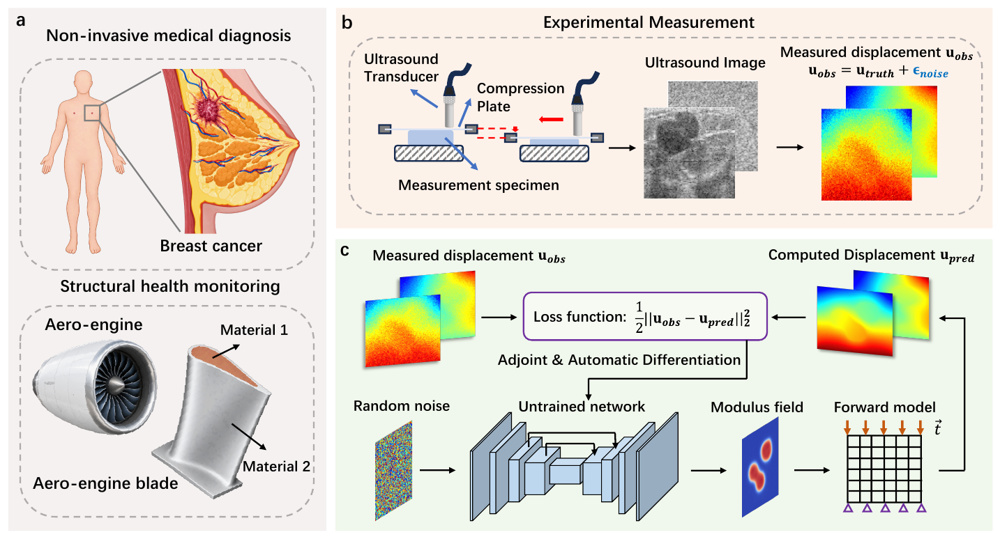

# EL-DIP

**A Deep Image Prior Framework for Accurate, Efficient, and Noise-Robust Elastography**

EL-DIP reconstructs heterogeneous shear modulus distributions from measured displacement fields using an untrained neural network coupled with a finite element model. The network is optimized for each reconstruction without an external training dataset.

*Framework overview.*

## Framework

The reconstruction combines a deep image prior, inverse distance weighting (IDW) interpolation, and a finite element method (FEM) solver:

1. A fixed random input is passed through an encoder-decoder network to generate a shear modulus field.
2. IDW interpolation maps the network output to the FEM mesh.
3. The FEM solver computes the displacement field for the current modulus distribution.
4. The discrepancy between computed and measured displacements defines the reconstruction loss.
5. Adjoint sensitivities and the IDW mapping are used to transfer gradients to the network for parameter updates.

## Code overview

| File | Description |
| --- | --- |
| `skip_net_cc_map.py` | Network architecture, adaptive output activation, IDW interpolation, and the custom FEM autograd interface. |
| `train_cc.py` | Example optimization workflow, noise input initialization, loss monitoring, and result visualization. |
| `gauss_noise.py` | Gaussian noise generation and displacement noise utilities. |

## Scope and dependencies

**This is a framework demonstration. The released files are not a standalone package for reproducing all results in the paper.**

The Python code uses **PyTorch, NumPy, Matplotlib, scikit-image, and tqdm**. The current FEM interface calls a Windows executable, `nlace.exe`.

The following components are referenced by the code but are **not included**:

- The FEM solver (`nlace.exe`).
- Solver-specific I/O utilities (`in_wenjian_cc.py`).
- Evaluation utilities (`test_method_cc.py`).
- FEM meshes, problem input files, displacement data, and experimental datasets.

Consequently, `train_cc.py` cannot run end to end from these files alone. To integrate a FEM backend, provide the corresponding I/O utilities and problem data, adapt the file paths, and create the output directories used by the example.

The main solver interfaces are `write_in` (write the modulus field), `dis_xy` (read computed displacements), and `read_grad` (read adjoint gradient data). A backend integration must check the gradient definition and loss normalization used by `FEM.backward`; the current callback does not use the numerical values of `grad_output`.

## License

The source code is released under the [MIT License](LICENSE).

The accompanying manuscript and figures reproduced from it retain their respective copyrights and are not covered by the software license.
